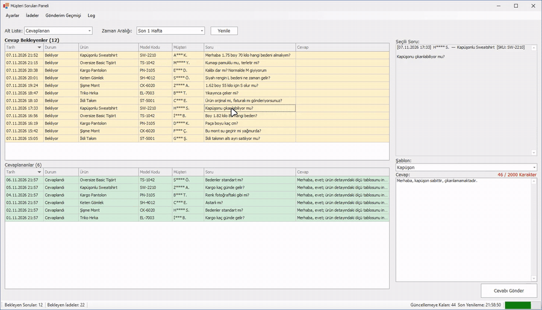
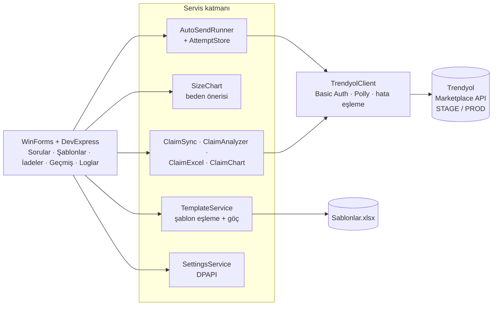
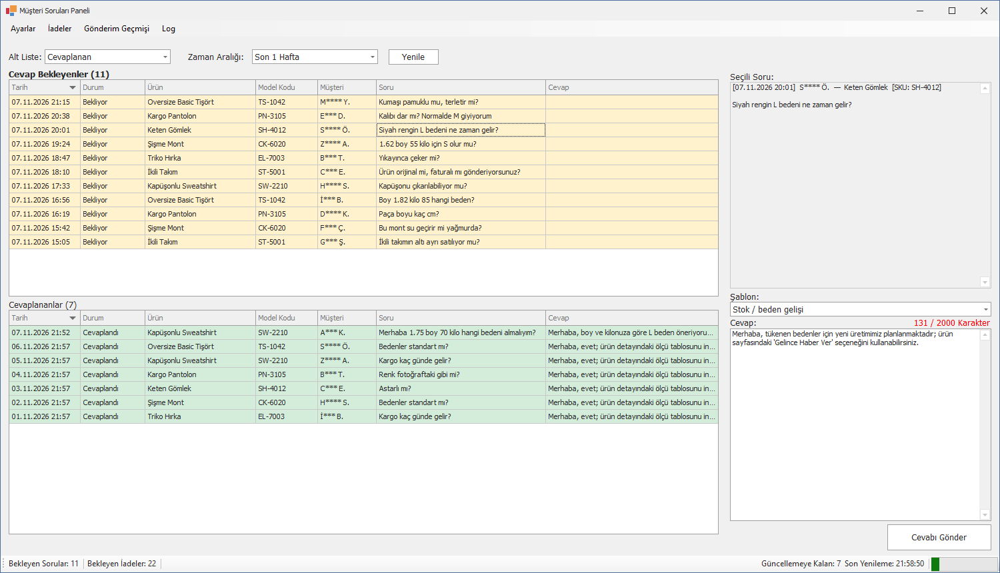
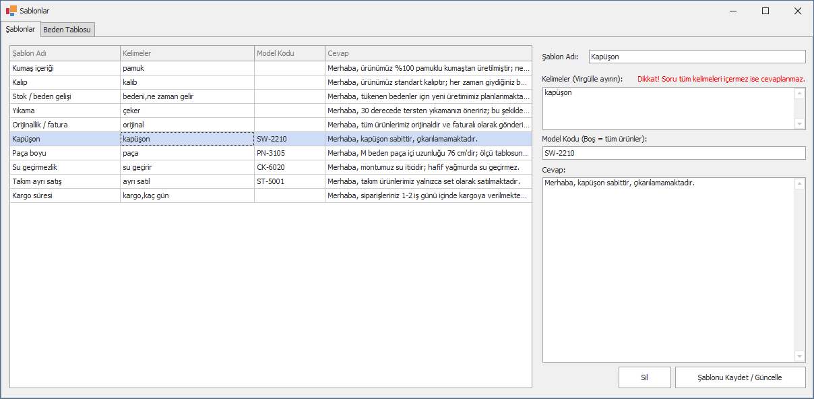
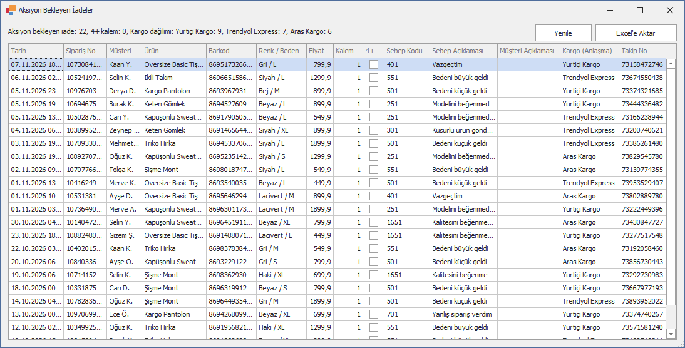
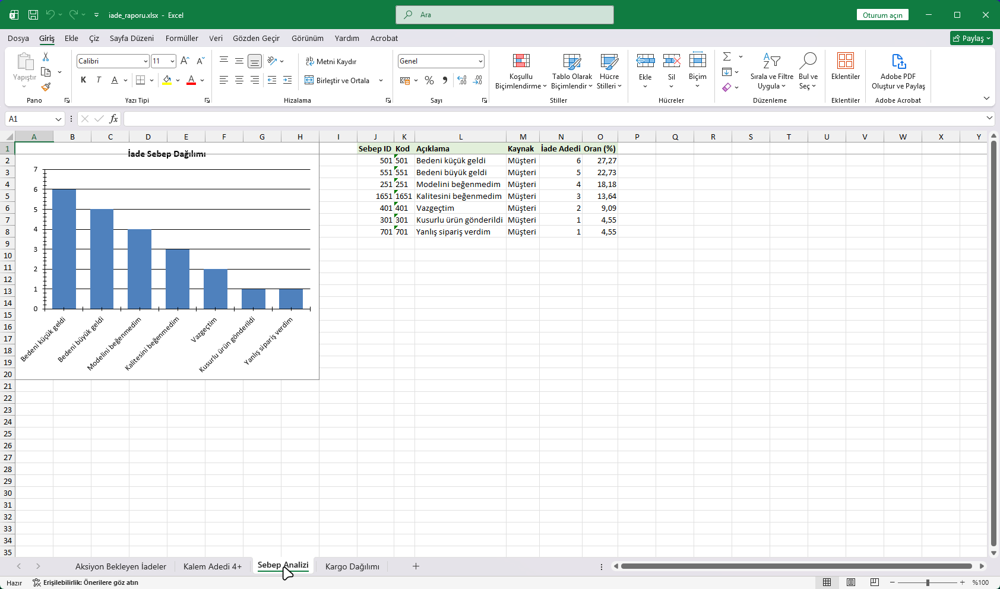

# Trendyol Cevaplama Botu — Müşteri Soruları ve İade Yönetim Paneli

**Trendyol ürün sayfalarındaki müşteri sorularını anahtar kelime + model kodu eşlemeli şablonlarla otomatik/yardımlı cevaplayan, bekleyen iadeleri izleyip grafikli Excel raporuna dönüştüren satıcı paneli.**

-lightgrey)

> **30 saniyede:**
> - **Problem:** Ürün sorularının ("Bu ürün kalıbı dar mı?", "175 cm 70 kg hangi beden?") her biri elle yazılıyordu; iadeler ise panelde dağınık duruyor, toplu analiz yapılamıyordu.
> - **Çözüm:** Resmî Trendyol API'si üzerinden soruları listeleyen, şablon önererek ya da tam otomatik cevaplayan; beden tablosu soruları için ölçüye göre beden hesaplayan; iadeleri sebep/kargo bazında analiz edip 4 sayfalı grafikli Excel üreten panel.
> - **Kanıt:** 80 birim testi, DPAPI ile şifrelenmiş API anahtarları, 429/5xx'e dayanıklı istemci, kapsamlı denetim (audit) sonrası risk giderme planıyla güçlendirilmiş kod tabanı.

  

<b>English summary</b>

A Windows desktop panel for a Trendyol marketplace seller. It lists customer product questions via the official Trendyol Q&A API and answers them manually, with template suggestions, or fully automatically using keyword + model-code matched templates stored in Excel. It includes a size-chart engine that answers "which size for 175 cm / 70 kg" questions, an auto-send runner with attempt tracking and duplicate protection, answer history, and a returns (claims) module that tracks waiting claims, flags 4+ item returns and exports a 4-sheet Excel report with charts. API keys are DPAPI-encrypted; the HTTP client handles 401/403/429/5xx with Polly. 80 MSTest tests. Source is private.

---

## Problem

Moda ürünlerinde müşteri soruları büyük ölçüde tekrar eder: kalıp, beden, kumaş, kargo süresi. Her soruya elle cevap yazmak hem zaman alıyor hem de cevap kalitesinin kişiye göre değişmesine yol açıyordu. Trendyol ayrıca cevapları gönderim sonrası **yasaklı kelime moderasyonundan** geçiriyor; reddedilen cevap soruyu yeniden "bekliyor" durumuna düşürüyordu.

İade tarafında ise "hangi ürün neden iade ediliyor, hangi kargo firmasıyla geliyor, çok kalemli iadeler kimde?" sorularının cevabı yoktu.

## Çözüm

### 1. Soru paneli
- Bekleyen / cevaplanan / reddedilen / şikâyetli soruları tarih aralığına göre listeler (API sınırları: sayfa başı 50, en fazla 2 hafta; Trendyol'un aralığı sessizce kırpıp en yeni soruları kaybettirmemesi için aralıklar 1 dk paylı hesaplanır).
- Üç çalışma modu: **elle cevap**, **şablonla otomatik doldurma**, **tam otomatik gönderim**.
- Gönderim öncesi doğrulama (10–2000 karakter, yalnız `WAITING_FOR_ANSWER` durumundaki sorular).
- **Gönderim geçmişi** ve **otomatik gönderim deneme kaydı**: aynı soruya iki kez cevap gitmesi engellenir.

### 2. Şablon motoru
- Anahtar kelime + model kodu eşlemeli şablonlar Excel'de tutulur; operasyon ekibi kod bilmeden düzenleyebilir.
- Eski 5 kolonlu şablon dosyaları yeni biçime **otomatik göç ettirilir**.
- Türkçe metin normalizasyonu (`TurkishText`): büyük/küçük harf, "ı/i", aksan farklarına dayanıklı eşleşme.

### 3. Beden tablosu
- Serbest metinden boy ve kiloyu çıkaran ayrıştırıcı: "1m65", "55-60 kilo" gibi yazımları anlar; "göğüs 85", "85B", "38 beden", "25 yaşındayım" gibi boy/kilo olmayan sayıları ayıklar.
- Excel'deki beden tablosundan (boy aralığı × kilo aralığı → beden) öneri üretir. Aralık verilen ve farklı bedenlere düşen sorularda **cevap vermez** — yanlış beden önermektense susmak tercih edilir.
- En kapsamlı test edilen modüllerden biri (`SizeChartTests`).

### 4. İade izleme
- `WaitingInAction` durumundaki iadeleri periyodik çeker, **4+ kalemli** iadeler için uyarı verir.
- Sebep ve kargo analizleri, kargo sözleşme numarasından taşıyıcı eşlemesi.
- **4 sayfalı, grafikli Excel raporu** (ClosedXML).

## Mimari

## Mühendislik kararları

- **Hata türüne göre davranış:** 401/403 (kimlik), 429 (oran sınırı, `Retry-After`), 5xx (geçici) ayrı istisna tiplerine eşlenir; Polly ile yeniden deneme.
- **Ortam ayrımı:** STAGE ve PROD API ortamları arasında geçiş; bağlantı test aracı (`ConnectionTester`).
- **Gizli bilgiler:** API anahtarı ve secret `%APPDATA%` altında Windows DPAPI ile şifreli.
- **Arayüze bağlı olmayan iş mantığı:** Test edilebilirlik için `IAnswerSender` gibi arayüzlerle soyutlanmış servisler.
- **Denetim → iyileştirme döngüsü:** Kod tabanı kanıta dayalı bir denetimden geçirildi; bulgular (ör. iade ayarlarının kaybolması, kullanılmayan ayar bayrağı, iyimser durum güncellemesi) önceliklendirilip bir risk giderme planıyla kapatıldı ve test kapsamı genişletildi.

## Kalite ve test

| Metrik | Değer |
|---|---|
| Üretim kodu | ~8.000 satır C# |
| Test | **80 MSTest** testi: şablon servisi, beden tablosu, otomatik gönderim, deneme kaydı, iade analizi/eşleme/senkron, cevap geçmişi, Türkçe metin |
| Dokümantasyon | Trendyol Müşteri Soruları API'si için iç teknik doküman |

## Teknoloji yığını

| Alan | Teknolojiler |
|---|---|
| Dil / Platform | C#, .NET Framework 4.8, WinForms |
| Arayüz | DevExpress 26.1 (grid, form, grafik) |
| HTTP | RestSharp, Polly |
| Excel | ClosedXML, OpenXML |
| Loglama | NLog |
| JSON | Newtonsoft.Json |
| Güvenlik | Windows DPAPI |
| Test | MSTest |

## Ekran görüntüleri

| | |
|---|---|
|  **Soru paneli** |  **Şablon yönetimi** |
|  **İade izleme** |  **Grafikli iade raporu** |

> Görsellerdeki sorular, müşteri adları, iade kayıtları, sipariş/kargo numaraları ve şablonlar kurgusaldır. Uygulama, izole bir demo kopyasında ayrı bir veri klasörüyle ve Trendyol API'si yerine 127.0.0.1 üzerinde çalışan sahte bir yerel API'ye bağlanarak çalıştırılmıştır; hiçbir müşteriye cevap gönderilmemiştir.

## Rolüm

Tek geliştirici: API entegrasyonu, şablon ve beden motoru, iade analitiği, test altyapısı ve denetim sonrası iyileştirmeler.

## Kaynak kodu hakkında

Bu depo bir **vaka çalışmasıdır**; kod ticari bir işletmeye ait olduğu için paylaşılmamaktadır. Görüşmede canlı demo ve kod incelemesi yapabilirim.

📫 **İletişim:** [GitHub profilim](https://github.com/furkan-karapinar)
